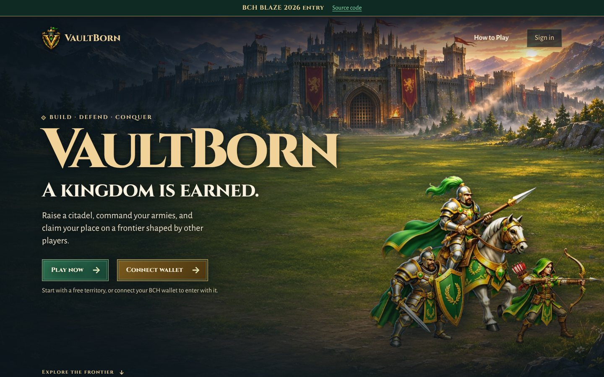
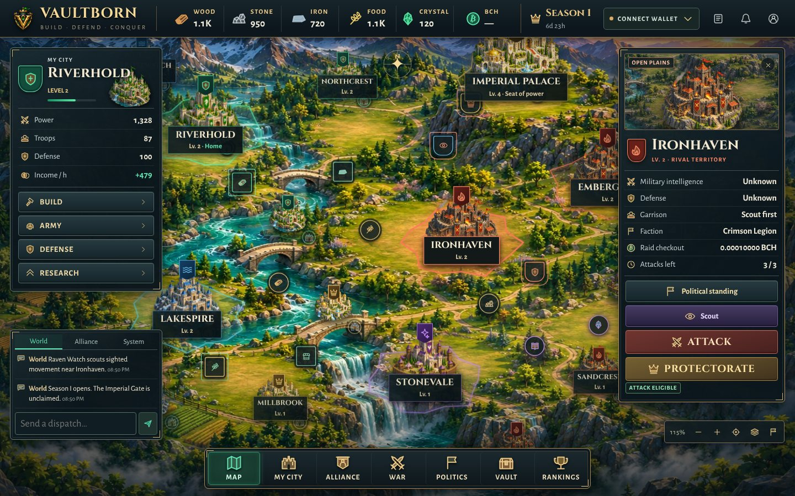
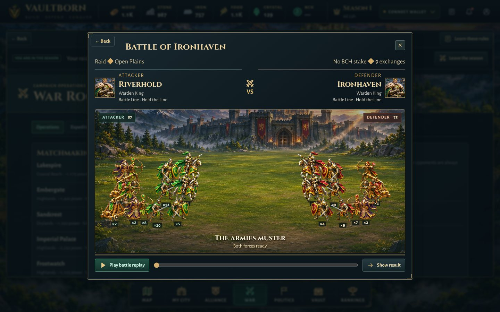
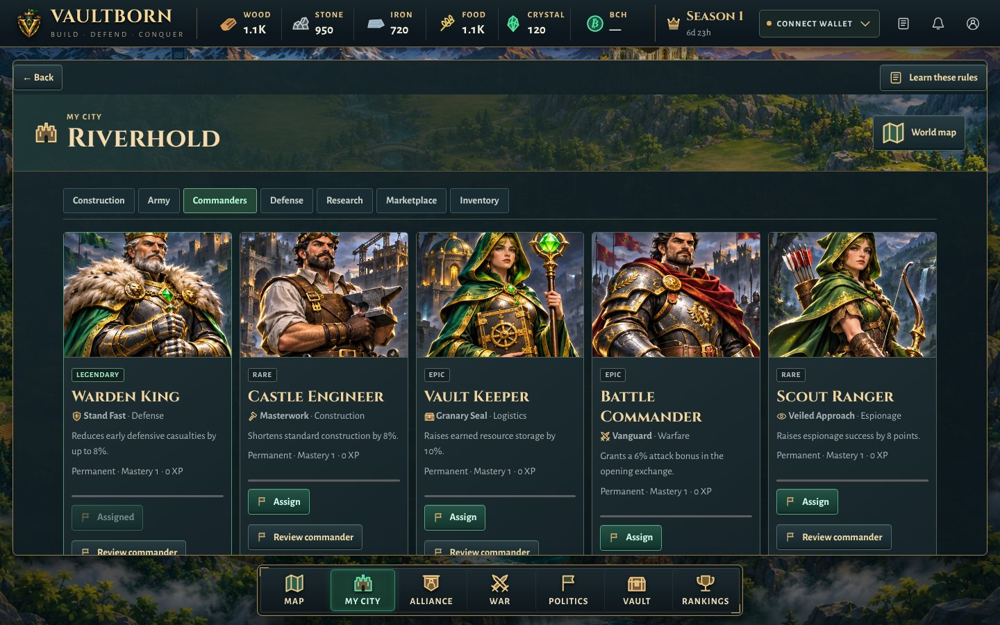
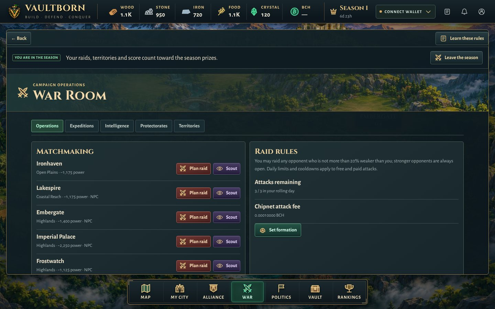
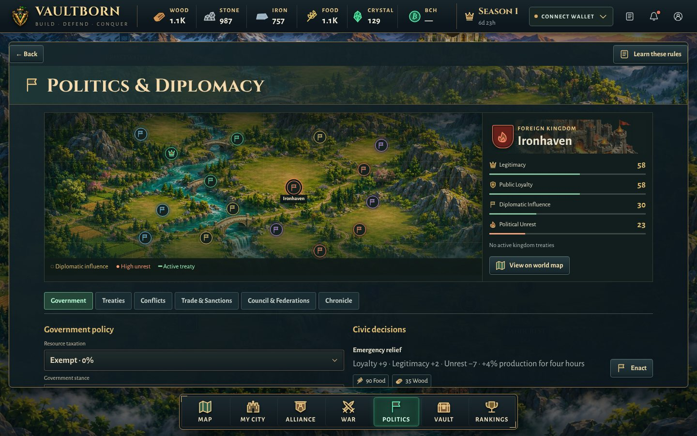
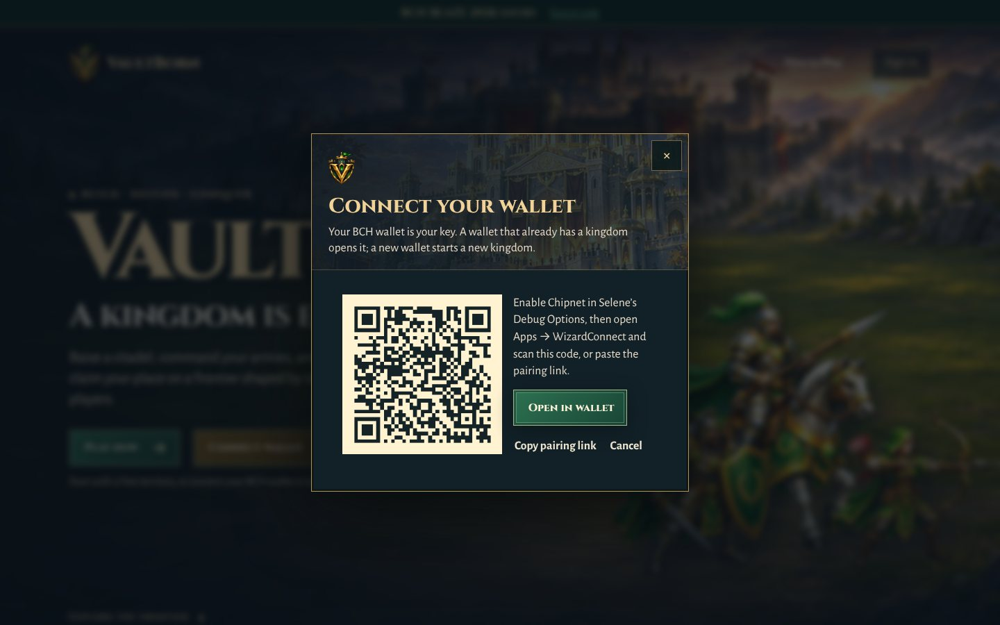
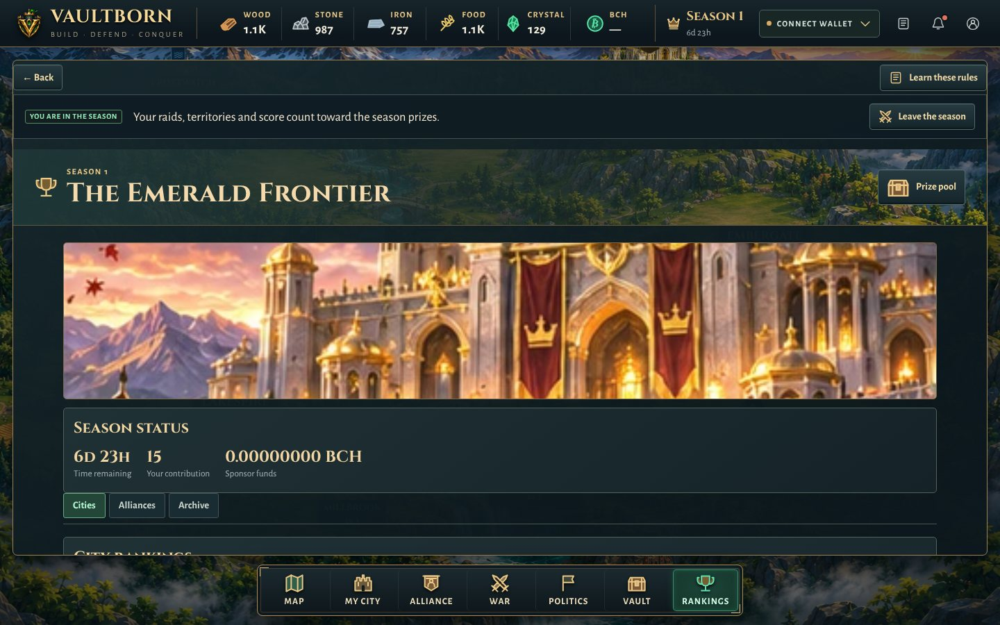
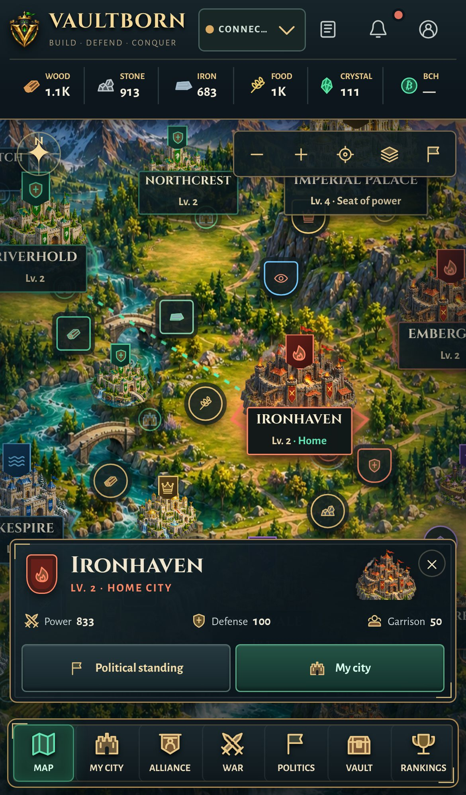
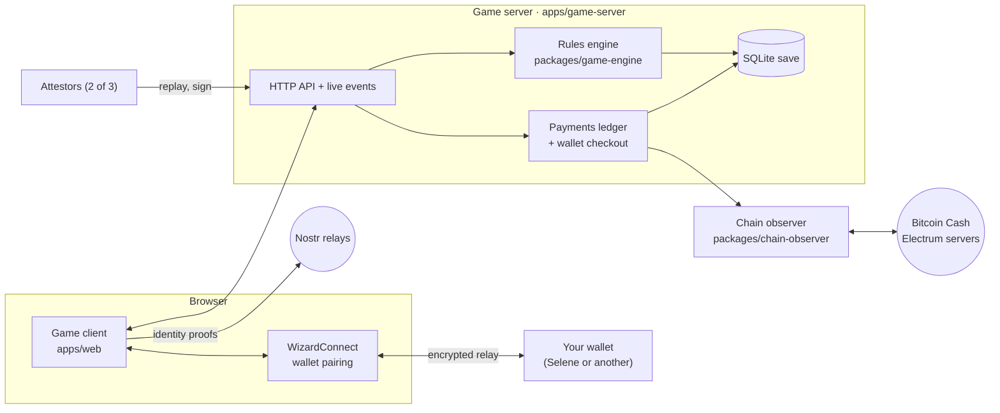

<div align="center">


# VaultBorn

**Build · Defend · Conquer**

A browser strategy game on Bitcoin Cash. Raise a citadel, command an army, sign treaties and raid your rivals.<br>
The game is free to play; every paid action is a Bitcoin Cash transaction that you approve in your own wallet.

[](docs/MAINNET.md)
[](#bch-blaze-2026)
[](docs/VAULTBORN_PROTOCOL.md)
[](xo/README.md)
[](docs/DECENTRALIZED_IDENTITY.md)
[](#run-it-yourself)
[](LICENSE)

### [▶ Play now at vaultborn.parhamlilian.com](https://vaultborn.parhamlilian.com) · [▶ Watch the trailer](brag-output/brag-narrated.mp4)

<a href="https://vaultborn.parhamlilian.com"></a>

</div>

---

## Contents

[What VaultBorn is](#what-vaultborn-is) · [Screenshots](#screenshots) · [How to play](#how-to-play) · [Bitcoin Cash in the game](#bitcoin-cash-in-the-game) · [BCH BLAZE 2026](#bch-blaze-2026) · [How it is built](#how-it-is-built) · [Run it yourself](#run-it-yourself) · [Tests and evidence](#tests-and-evidence) · [Repository map](#repository-map) · [Known limits](#known-limits) · [License](#license)

## What VaultBorn is

VaultBorn is a persistent kingdom strategy game that runs in the browser, on a computer or a phone. Every player rules one city on a shared frontier map, next to other players and computer-run kingdoms.

- **Build** a city with ten kinds of buildings, research upgrades and claim your daily supplies.
- **Command** a six-class army (infantry, shield bearers, archers, cavalry, siege and mages) led by one of eight commanders, each with its own trait.
- **Fight** rivals with formations and tactics. Every battle is calculated by the server from a recorded seed, so anyone can replay it and check the result.
- **Rule** through politics: government policy, treaties, protectorates, trade routes, sanctions, alliance and federation councils, and internal conflicts.
- **Compete** in seasons. Raids, territories and contributions earn season score, and the best players share a prize pool paid in BCH.

The free game needs no wallet. Bitcoin Cash comes in only when you choose a paid action, and then your own wallet shows every output and the fee before you approve anything.

## Screenshots

<table>
  <tr>
    <td width="50%"><br><sub><b>The frontier.</b> Your city, rival kingdoms, resource sites and the Imperial Palace on one map.</sub></td>
    <td width="50%"><br><sub><b>Battles you can replay.</b> Every raid is recorded with its seed and can be played back exchange by exchange.</sub></td>
  </tr>
  <tr>
    <td><br><sub><b>Eight commanders.</b> Each changes how your army fights, builds or gathers, and grows with mastery.</sub></td>
    <td><br><sub><b>The war room.</b> Choose an opponent, scout first, then launch a free raid or a paid raid with matched stakes.</sub></td>
  </tr>
  <tr>
    <td><br><sub><b>Politics and diplomacy.</b> Legitimacy, loyalty, influence and unrest, with treaties and councils.</sub></td>
    <td><br><sub><b>Your wallet is your key.</b> Pair Selene or another WizardConnect wallet by scanning one code.</sub></td>
  </tr>
  <tr>
    <td><br><sub><b>Seasons.</b> Every kingdom is in the season from day one: follow the rankings and the prize pool.</sub></td>
    <td align="center"><br><sub><b>On a phone.</b> The same game, laid out for a small screen.</sub></td>
  </tr>
</table>

## How to play

1. Open **[vaultborn.parhamlilian.com](https://vaultborn.parhamlilian.com)** and choose **Play now** to found a new city, or **Connect wallet** to enter with your Bitcoin Cash wallet. A wallet that already has a kingdom opens it, from any browser.
2. Name your city and choose a faction. Everything is open from the first day: building, training, commanders, raids and the season. The in-game **Campaign guide** walks you through the first steps if you want it, and pays a reward at the end.
3. Build and train in **My City**, assign a commander under **Commanders**, then go to **War**. You may raid any opponent who is not more than 20% weaker than you; stronger opponents are always open. Scout before you attack.
4. Use **Politics** to set policy and sign treaties, **Alliance** to join forces, and **Rankings** to follow the season.
5. When you want to pay for something, the game shows the price, and your wallet shows the transaction. Nothing is sent until you approve it in the wallet.

## Bitcoin Cash in the game

<details open>
<summary><b>Your wallet is your account</b></summary>

When you pair a wallet through WizardConnect, the game asks it once to sign a **proof**: a transaction that names a coin which does not exist and returns the same amount to your own address. It is never broadcast and could not be confirmed; it only shows that the wallet holds the key. After that the wallet is linked to your kingdom: rewards and withdrawals are paid to it, and it opens your kingdom from any browser. No seed phrase, private key or password is ever asked for. Details: [docs/DECENTRALIZED_IDENTITY.md](docs/DECENTRALIZED_IDENTITY.md).
</details>

<details open>
<summary><b>Where the money goes</b></summary>

| Payment | Split, made by the payer's own transaction |
| --- | --- |
| Services (rush, premium building, espionage, protectorate, political operation; from 20,000 satoshis) | **50%** into the payer's War Chest · **20%** season prizes · **20%** development · **10%** burned |
| Sponsorship of a season (from 0.25 BCH) | **30%** development · **70%** season prizes |
| War Chest deposit | 100% into the player's own War Chest contract |

Network reserves are shown separately from the price. Every output is visible in the wallet before approval. The full list of transactions the game can cause is in [docs/BLOCKCHAIN_TRANSACTION_MATRIX.md](docs/BLOCKCHAIN_TRANSACTION_MATRIX.md); prices are in [config/pricing.mjs](config/pricing.mjs).
</details>

<details open>
<summary><b>The War Chest and matched-stake raids</b></summary>

Each player has one BCH treasury, the **War Chest**: a contract on the player's own script, and all of it is at risk in paid PvP. A paid raid uses **matched stakes**: the attacker chooses a stake S (from 10,000 satoshis), and the raid is offered only if the defender's War Chest covers S. If the attacker wins, one transaction pays the attacker both stakes; if the defender wins, the defender receives the attacker's whole stake. Free raids use the same combat and never move BCH. Contracts: [docs/TREASURY_COVENANTS.md](docs/TREASURY_COVENANTS.md), economy: [docs/ECONOMY_DESIGN.md](docs/ECONOMY_DESIGN.md).
</details>

<details open>
<summary><b>Attestors</b></summary>

Raid outcomes and prizes need the signatures of two of three **attestors**, who replay the recorded battle and audit the season before signing. The game key alone cannot move player or prize money. In this deployment the attestors are run by the VaultBorn team, not by independent parties, and the game's rules say so. They can be replaced by attestors run by other people. See [docs/ATTESTOR_GUIDE.md](docs/ATTESTOR_GUIDE.md).
</details>

<details>
<summary><b>CashTokens, territories and treaties</b></summary>

Territory deeds and treaty charters can be issued as CashTokens collectibles. Territory contests use stakes in escrow contracts, and treaty compensation can be locked in an escrow that an arbiter can only release to the named recipient or return to the payer. See [docs/TERRITORY_PROTOCOL.md](docs/TERRITORY_PROTOCOL.md) and [docs/POLITICAL_MECHANICS.md](docs/POLITICAL_MECHANICS.md).
</details>

<details>
<summary><b>Mainnet transactions (proof)</b></summary>

The Mainnet launch of the game was recorded on chain in transaction [`7e5d53bb…a74db7cc`](https://blockchair.com/bitcoin-cash/transaction/7e5d53bbf8586c6474982f1e6c1e11a26d5444e607c0221c85a7cf1ea74db7cc) (block 978,040). Its data output carries the SHA-256 hash of the [launch manifest](docs/mainnet/launch-manifest.json): the game's public key, the three attestor keys, the 2-of-3 threshold, the price book and the contract versions. The first game payments followed in block 978,066: a territory claim ([`29dc9fc2…`](https://blockchair.com/bitcoin-cash/transaction/29dc9fc2022f0acc2391eb50646f93fd7558058d6ae3499a996c5d07f1064483), 6,600 sat into a stake escrow) and a War Chest deposit ([`3364cea4…`](https://blockchair.com/bitcoin-cash/transaction/3364cea414af757ad4e34ba78c24aa61b34f6e2208893c716037ff88fdb9eb46), 10,000 sat into a War Chest contract). In block 978,094 the claim settled: two of the three attestors signed the escrow's return lane and the 6,000 sat stake went back to the claimant's wallet ([`1022549a…`](https://blockchair.com/bitcoin-cash/transaction/1022549ae29f30d57b3327f6f381f553375a5227c197390b0564fd4a6f7a8505)). The list, and how to check every one offline with `npm run verify:mainnet`, is in [docs/MAINNET_TRANSACTIONS.md](docs/MAINNET_TRANSACTIONS.md). Anyone can compare it with the rules the game runs.
</details>

## BCH BLAZE 2026

VaultBorn is entered in the BCH BLAZE 2026 hackathon:

| Track or bounty | What VaultBorn brings | Where |
| --- | --- | --- |
| **Mainnet Track** | Live on Mainnet at [vaultborn.parhamlilian.com](https://vaultborn.parhamlilian.com). Paid actions are wallet-signed Bitcoin Cash Mainnet transactions through WizardConnect; the home page carries the BLAZE banner. | [Mainnet transactions (proof)](docs/MAINNET_TRANSACTIONS.md), [docs/MAINNET.md](docs/MAINNET.md), [config/blaze.json](config/blaze.json) |
| **Build with XO** | A treaty and protectorate compensation escrow as an XO template, tested in the XO engine, with a Chipnet runner. | [xo/](xo/README.md) |
| **Decentralized Identity** | A kingdom bound to both a BCH key and a Nostr key, published to and discovered from public Nostr relays, and verifiable by anyone. | [docs/DECENTRALIZED_IDENTITY.md](docs/DECENTRALIZED_IDENTITY.md), [public-relay run](docs/IDENTITY_PUBLIC_RELAY_RUN.json) |

The game runs at **[vaultborn.parhamlilian.com](https://vaultborn.parhamlilian.com)** on Bitcoin Cash Mainnet. The BLAZE banner at the top of its home page links to the [presentation](https://docs.google.com/presentation/d/1CPrmv3eMdY-d4T-1jlzeaIJjqFChHq8enlrpVClCOv8/edit?usp=sharing) and to this repository, and shows the CashTokens address for EMBER2026 community-choice tokens. The trailer is [brag-output/brag-narrated.mp4](brag-output/brag-narrated.mp4) (also on the home page). Where everything stands, with the evidence for each part: [docs/STATUS.md](docs/STATUS.md). VaultBorn was first developed under the name *BCH Dominion*.

## How it is built



- **Rules engine** (`packages/game-engine`): the whole game, deterministic and independent of the network. Battles are seeded and replayable.
- **Game server** (`apps/game-server`): Node.js with the built-in `node:sqlite`; sessions, API, live updates and the payments ledger.
- **Chain observer** (`packages/chain-observer`): builds contract addresses, checks payments on Electrum servers (two independent ones on Mainnet), and settles raids, prizes and withdrawals with the attestors' signatures. Built on [Libauth](https://libauth.org).
- **Client** (`apps/web`): plain JavaScript modules and CSS, no framework; WizardConnect for the wallet.
- **Identity** (`packages/decentralized-identity`): BCH and Nostr key binding, relay publishing and discovery.

More: [ARCHITECTURE.md](ARCHITECTURE.md), [docs/VAULTBORN_PROTOCOL.md](docs/VAULTBORN_PROTOCOL.md), [docs/GAME_DESIGN_DOCUMENT.md](docs/GAME_DESIGN_DOCUMENT.md).

## Run it yourself

> The [license](LICENSE) allows running this code only to evaluate the BCH BLAZE 2026 entry. For anything else, ask the author first.

Requires **Node.js 24** or newer.

```sh
npm ci
npm run preview:offline     # the whole game in memory, with every BCH connection switched off
```

Open <http://127.0.0.1:4173/> and choose **Play now**. To see a kingdom that has been played, open `/?seat=p1` in a private window (seats `p1` to `p4`).

| Command | What it starts |
| --- | --- |
| `npm run preview:offline` | The game in memory, no blockchain, no wallet. |
| `npm run preview:wallet` | The same, with wallet pairing switched on (contacts the public WizardConnect relays). |
| `npm start` | The game on Chipnet test coins with a saved world. Run `npm run configure:chipnet` once first. |
| `docker compose up --build` | A local container demo. |

One server runs on one network, chosen by `VAULTBORN_NETWORK`: `chipnet` (default, test coins) or `mainnet` (real BCH). Mainnet refuses to start until the operator has authorised it and every safety check passes; see [docs/MAINNET.md](docs/MAINNET.md). Keep `.env` files, key files and databases private: they are ignored by git.

## Tests and evidence

```sh
npm test                  # 265 unit and integration tests: rules, ledger, contracts in the BCH virtual machine, identity, server set-up
npm run test:browser      # the game in a real browser: map, raids, politics, wallet proof, mobile layout
npm run test:wallet:connect   # connecting a wallet with the official WizardConnect wallet SDK
npm run verify:mainnet    # the Mainnet transactions, checked offline
npm --prefix xo ci        # once: the XO engine and its tools (builds a native SQLite module; on Windows this needs the C++ build tools)
npm run test:xo           # the XO treaty escrow template in the XO engine, on a local chain
npm run simulate          # economy and balance simulations
```

[docs/STATUS.md](docs/STATUS.md) lists what runs where, with the evidence: the Mainnet transactions ([docs/MAINNET_TRANSACTIONS.md](docs/MAINNET_TRANSACTIONS.md)), the identity run on public Nostr relays ([docs/IDENTITY_PUBLIC_RELAY_RUN.json](docs/IDENTITY_PUBLIC_RELAY_RUN.json)), Chipnet transactions of payments, territory contests, political escrows and CashTokens (`docs/*_RECEIPTS.json`, `docs/*_CHIPNET*.json`), Regtest runs of the contracts, and the browser and wallet test results ([docs/audit/](docs/audit)). The dated audit reports in `docs/audit/` record the state on the day each was written.

## Repository map

| Folder | Contents |
| --- | --- |
| [`apps/game-server`](apps/game-server) | Game server, API, sessions, payment ledger, wallet checkout, identity |
| [`apps/web`](apps/web) | Browser client, start page, Chain Explorer and Council pages |
| [`packages/game-engine`](packages/game-engine) | Rules: economy, combat, commanders, politics, territories, NPC kingdoms |
| [`packages/chain-observer`](packages/chain-observer) | Bitcoin Cash contracts, transaction building and checking |
| [`packages/decentralized-identity`](packages/decentralized-identity) | BCH and Nostr identity binding |
| [`packages/assets`](packages/assets) | Game art and music, catalogued in `manifest.json` |
| [`config`](config) | Prices, economy, balance, network profiles, the BLAZE banner |
| [`xo`](xo) | XO treaty escrow template, test and Chipnet runner |
| [`infrastructure`](infrastructure) | Container and server set-up for a hosted game |
| [`scripts`](scripts) | Simulations, browser tests, attestor tools, utilities |
| [`tests`](tests) | Integration tests |
| [`docs`](docs) | Design, economy, protocols, security, audits and evidence |

## Known limits

Stated plainly, as they are:

- **Credit is not a refund.** A paid service that cannot be delivered when its payment confirms becomes a credit for the same service in the game. No BCH is sent back.
- **The attestors are run by the VaultBorn team** in this deployment, so raid and prize outcomes rest on the team's signatures until other people run attestors.
- **No third-party audit yet.** The contracts run in the Bitcoin Cash virtual machine, on a Regtest node, on Chipnet (earlier versions) and on Mainnet; see [docs/STATUS.md](docs/STATUS.md).
- **Wallets.** The game speaks WizardConnect. The Mainnet payments so far were signed in Selene; pairing and the wallet proof are also tested with the official WizardConnect wallet SDK.

Security notes, and how to report a problem privately: [SECURITY.md](SECURITY.md).

## License

**All rights reserved.** This repository is public so that it can be read and judged; it is **not** open source. You may view the code on GitHub, and the BCH BLAZE 2026 judges may run it to evaluate the entry. Copying, modifying, hosting, redistributing or reusing any part of it, including the art, music and names, needs the author's written permission. See [LICENSE](LICENSE).

Third-party components keep their own licenses: see [docs/THIRD_PARTY.md](docs/THIRD_PARTY.md).

<div align="center"><sub>VaultBorn · made for Bitcoin Cash · BCH BLAZE 2026</sub></div>
