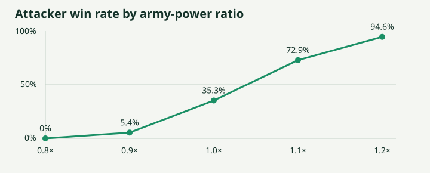

# Combat balance

New battles use versioned cavalry terrain and fatigue rules. Historical combat records and ongoing legacy campaigns keep their original resolver. The [progression and stats audit](PROGRESSION_AND_STATS.md) records the current rules and the paired before/after comparison; older baseline measurements below remain useful historical evidence.

The server resolves nine exchanges over a 54-second replay timeline. A battle receipt includes both troop rosters, attacker and defender posture, formations, hero and tech, terrain, bounded scouting bonus, deterministic seed, input commitment, integer losses by unit, timeline and result hash. Both participants can reproduce the result with `simulateBattle(input, seed)`. Auditing trusts the operator to maintain the persisted command and secret history. The system has no external pre-battle timestamp or independent randomness oracle.

## Combat rules

- Composite power weights attack, guard and life at 50%, 30% and 20%, applies researched War Doctrine, and adds wall and civic development. Normal target power must be within 80–120% of the attacker.
- Each round computes damage for both armies from the same pre-round state. Unit multipliers depend on opposing troop composition. A Spearhead favors infantry and cavalry, a Screen favors archers and mages, and a Battle Line is neutral.
- Assault front-loads damage and exposes its troops. Flank responds to Assault and increases cavalry pressure. Siege improves siege-weapon pressure and reduces fortification effects. A War Mage pulses every third round. Commander and Warden Hero modifiers are bounded to early exchanges.
- Terrain and walls contribute to defender pressure and survival. Seeded attack variance ranges from 0.88× to 1.12× with a reciprocal defender factor.
- Per-unit losses are limited to 48% of each force. There is no protection shield after a defeat this season; the daily raid limits and the eight-hour pause between the same two kingdoms apply instead. Normal battles transfer only bounded earned resources and may transfer a landmark below the receiving cap. Skill and timing affect both free and paid battles.

### Unit counter matrix

Rows show the attacking unit. Columns show the opposing unit.

| Unit | Infantry | Shield | Archer | Cavalry | Siege | Mage |
|---|---:|---:|---:|---:|---:|---:|
| Infantry | 1.00 | 0.82 | 1.15 | 0.90 | 1.23 | 1.07 |
| Shield | 1.17 | 1.00 | 0.97 | 1.25 | 0.88 | 0.86 |
| Archer | 1.19 | 0.83 | 1.00 | 0.74 | 1.05 | 1.20 |
| Cavalry | 1.08 | 0.72 | 1.31 | 1.00 | 1.20 | 0.86 |
| Siege | 0.79 | 1.27 | 0.86 | 0.78 | 1.00 | 1.07 |
| Mage | 0.98 | 1.22 | 0.88 | 1.14 | 0.89 | 1.00 |

## Executed simulation

`npm run simulate` resolved 12,000 baseline battles across five nominal army-power bands, five roster profiles, compositions and tactical combinations. Each case was also resolved with the same seed under a paid marker and under fresh high-confidence intel, for 36,000 resolutions of the final rules. A separate baseline reran the earlier tuning for comparison. The ratios below refer to army strength before terrain, walls, tech and tactical modifiers. The runtime matchmaking ratio includes walls and maturity.

| Attacker/defender army ratio | Attacker win | Balanced | Assault | Flank | Siege |
|---|---:|---:|---:|---:|---:|
| 0.8 | 0.0% | 0.0% | 0.0% | 0.2% | 0.0% |
| 0.9 | 5.4% | 4.7% | 4.2% | 9.8% | 3.0% |
| 1.0 | 35.3% | 36.7% | 27.3% | 44.3% | 32.7% |
| 1.1 | 72.9% | 75.0% | 66.5% | 80.5% | 69.7% |
| 1.2 | 94.6% | 95.2% | 90.2% | 98.3% | 94.7% |

The first pass had a 22.2% equal-army attacker win rate and 60.3% at 1.1×. Reducing terrain and wall influence to 0.52 of the earlier coefficient raised the equal-army win rate to 31.1% with the original 8% variance bound. The final 12% bound raised equal-army wins to 35.3% and reduced deterministic wins for stronger attackers. Plains and river-crossing attacker win rates were 47.5% and 35.8% across all five power bands. Flank was the strongest tactic under this randomized opponent distribution, as its bonus triggers against Assault and its cavalry specialization can align with high power. Focused live testing should compare formation picks against informed human opponents before further adjusting the counter matrix.

The payment marker changed zero paired outcomes. Fresh intel at 84% confidence flipped 548 of 12,000 cases and raised wins by 4.57 percentage points. It remains possible to lose with strong intel. The simulation only varies combat inputs. It cannot detect cheating, player collusion or incentive-driven selection among live opponents. [Raw output and earlier coefficients](economy-simulation-results.json).



## Regression commands

```sh
node --test packages/game-engine/engine.test.mjs packages/economy-simulator/balance.test.mjs
npm run simulate
```

The automated checks cover deterministic replay, troop conservation, caps, onboarding shields, identical paid and free combat rules, useful but limited intel, post-defeat recovery, treaty conflicts, settlement ownership, protectorate response and rebellion resolution.
